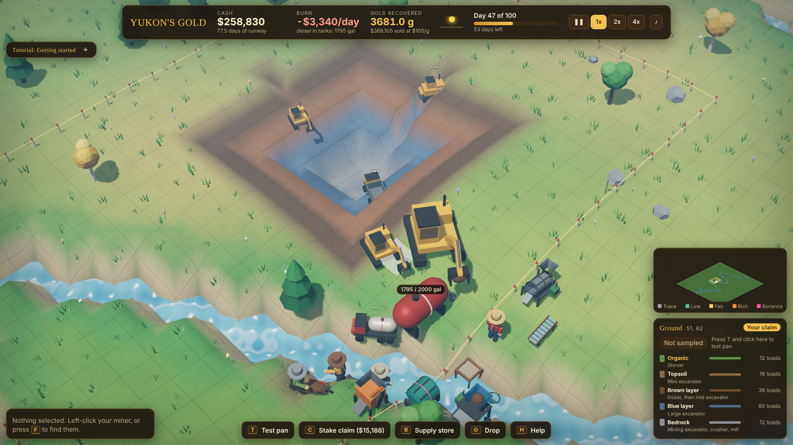

# Yukon's Gold



Yukon's Gold is a gold mining strategy game that runs in a browser tab. You start with a shovel, a sieve, a bucket, a gold pan and $1,000. The bills come to $50 a day. You have one hundred days to turn that into a bedrock mine.

**[Play it here](https://kylegothman.github.io/yukons-gold/)**. It wants a mouse and a keyboard.

## What you actually do

You walk the creek and test pan the ground until something shows color. You stake a claim on it. Then you dig a bucket of dirt, shake it through the sieve, and wash it in the pan. That first flake of gold pays for a hired hand, and the hand pays for a sluice box.

From there the game is about scale. A mini excavator replaces the shovel. A trommel replaces the sieve. A dozer rips the hard brown layer so a bigger excavator can get under it. Under that is blue clay, and under that is bedrock, which is where the real money is and which needs a crusher and a mill to give it up.

Two rules keep it honest. Everything costs money every day, whether it is working or not. And a pit can only go one layer deeper than the ground around it, so a deep mine has to be a wide one.

## Running it yourself

You need Node 22 or newer.

```
npm install
npm run dev
```

That is the whole setup. Vite prints a URL. Open it.

If you would rather not install anything, `dist/index.html` is the entire game in one file. Double-click it.

## How it is put together

The game is two programs that barely know each other.

`src/sim` is the simulation. It is plain TypeScript with no rendering code in it at all. It advances ten ticks a second, every player action reaches it as a small command object, and all of its randomness comes from one seeded generator. Give it the same seed and the same commands and you get the same game, every time. That makes it easy to test, and it is the reason a bot can play a full hundred-day season in about two seconds.

`src/view` is everything you see and hear. It draws the simulation with Three.js and turns clicks into commands. It is not allowed to change the game directly.

There are no art or audio files. Every model is built from boxes and cylinders in code, and every sound is synthesized when it plays. The build is a single HTML file.

Every number that affects balance lives in `src/data/balance.ts`. If something feels too cheap or too slow, that is the only file you should need.

```
src/
  sim/          the game rules, deterministic, no rendering
  data/         every tunable number
  view/         Three.js scene, HUD, sound
tests/          simulation tests
scripts/        the balance bot
docs/           design document and decision records
```

## Checking your work

```
npm test            the simulation tests
npm run balance     a bot plays 12 full seasons and reports how far it got
npm run ci          typecheck, tests and a production build, exactly what GitHub runs
npm run preview     serve the production build locally
```

Run `npm run ci` before you push. It is the same command the GitHub workflow runs, so if it passes on your machine it passes there. `npm install` also sets up a pre-push hook that runs it for you. If you ever need to skip the hook, `git push --no-verify` does that.

The balance bot is worth knowing about. It only sends commands a player could send, so when it gets stuck, a player could get stuck the same way. It has already found three real bugs like that.

## Deploying

Pushing to `main` runs the tests, builds the game, and publishes it to GitHub Pages. There is nothing else to do.

## Further reading

- [The design document](docs/DESIGN.md): every rule and every number, in one place.
- [Decision records](docs/adr): why the code is shaped the way it is.

## License

Copyright (c) 2026 Kyle Gothman. All rights reserved.

This code is public so it can be read. It is not open source. You may not copy, modify or redistribute it without written permission.
